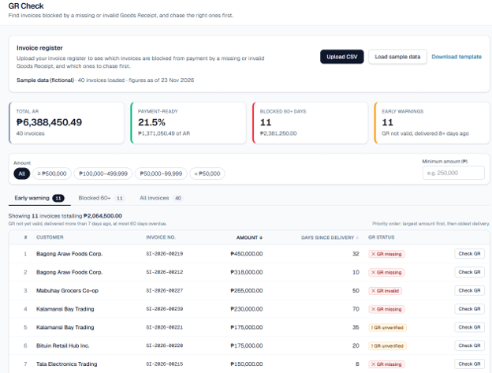
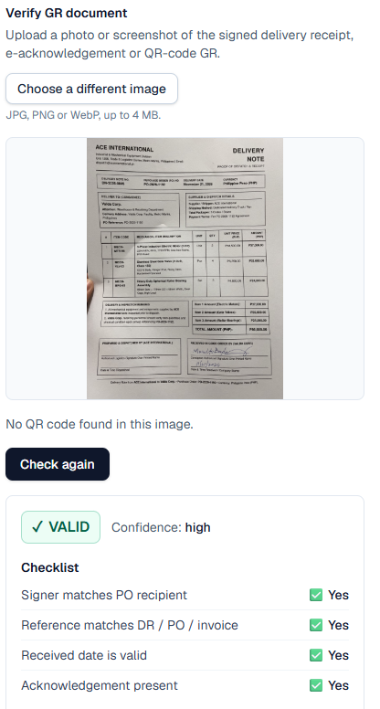

# GR Check

**Find invoices blocked by a missing or invalid Goods Receipt, verify GR documents with AI, and draft the right follow-up, within 7 days of delivery instead of at 120+ days overdue.**

**Live demo:** https://gr-check-woad.vercel.app · click **Load sample data** (fictional invoices, no upload needed)

[](https://github.com/mr-niconico/4.2-Assignment/actions/workflows/ci.yml)



*The dashboard after **Load sample data**: total AR, % payment-ready, blocked 60+ and early warnings, with the early-warning list ranked by amount.*



*The **Check GR** panel: the uploaded (fictional) delivery note is read by the AI and checked by code, giving **VALID** with high confidence and all four checks passed.*

---

## Contents
1. [The problem](#the-problem)
2. [How it works](#how-it-works)
3. [Features: AI vs code](#features-ai-vs-code)
4. [Tech stack](#tech-stack)
5. [Run locally](#run-locally)
6. [Testing](#testing)
7. [Security & cost controls](#security--cost-controls)
8. [Known limitations](#known-limitations)
9. [AI coding rules](#ai-coding-rules)
10. [Project documents](#project-documents)
11. [Roadmap](#roadmap) · [License](#license) · [Author](#author)

---

## The problem

Philippine B2B suppliers often carry invoices **60+ days overdue that the customer will not pay yet**: the invoice is not payment-eligible because the **Goods Receipt (GR)** is missing, or it was not acknowledged by the customer's authorised recipient (the person named in the Purchase Order).

- **Found late.** In interviews with 3 credit professionals, all discovered GR problems only when the customer replied to the Statement of Account, when the invoice was already overdue, or at 120+ days with the credit limit maxed out.
- **Hardest with courier deliveries**, where nobody checks the GR at the door.
- **Blocks new orders.** The overdue balance triggers a credit hold, so a paperwork gap turns into lost sales.
- **Manual tracking fails** across 1,000+ customer accounts.

**Target user:** a credit officer at a Philippine B2B supplier managing many customer accounts, who needs to catch GR problems **within 7 days of delivery**, while they are still easy to fix.

## How it works

```
1. Upload            2. Readiness dashboard        3. AI GR check              4. AI follow-up
invoice CSV   ──▶    KPIs, early warnings,   ──▶   photo / screenshot /  ──▶   draft to the right
(or sample data)     blocked 60+, all invoices     QR-code GR → verdict        team, ready to copy
```

1. **Upload** the invoice register (CSV) or click **Load sample data**. Every row is validated; bad rows are listed with their row number.
2. **Dashboard:** KPI tiles (total AR, % payment-ready, blocked 60+, early warnings) and three tabs:
   - **Early warning:** GR not valid and delivered more than 7 days ago, ranked by amount, then days since delivery.
   - **Blocked 60+:** grouped by main blocker (GR, POD, dispute) with subtotals.
   - **All invoices:** search plus blocker and aging filters.
   - An **amount filter** (presets and a minimum amount) and **sortable columns** focus on high-value invoices.
3. **Check GR:** upload a photo of the delivery receipt, an e-acknowledgement screenshot or a QR-code GR. The browser decodes any QR code first; the AI reads the document; code applies the guards. The result card shows **VALID / INVALID / NEEDS REVIEW**, confidence, a ✅/❌/❓ checklist, extracted fields and reasons. The invoice's GR status updates and the dashboard recalculates.
4. **Draft follow-up:** code picks the recipient (logistics, customer receiving, sales or customer AP); the AI writes a short, polite message quoting the invoice, PO and DR numbers and the amount, with a target date 3 working days away. **Copy** and send.

## Features: AI vs code

**Rule of the project: calculations in code, judgement in AI.** Anything that must be exact and repeatable (dates, money, rules) is code with unit tests; the AI only does what code cannot: read a document and write a message.

| Feature | Done by | Why |
|---|---|---|
| CSV parsing and validation (headers, dates, amounts, statuses, duplicates, 5,000-row / 2 MB limits) | **Code** (PapaParse + Zod) | Must be exact; errors reported by row number |
| Business rules R1–R8: days overdue, aging buckets, payment-ready (GR valid + POD received + no dispute), blockers, blocked 60+, early warning, priority | **Code** (`lib/readiness.ts`) | Pure functions with `today` passed in, so every boundary is unit-tested |
| Amount filters, sorting, totals | **Code** (`lib/amountFilter.ts`) | Totals added in centavos, no rounding drift |
| QR-code decoding | **Code** (jsQR, in the browser) | Vision models cannot reliably read QR codes |
| **Reading the GR document:** document type, signer, signature, stamp, received date, references | **AI** (vision) | Handwriting, stamps and screenshots vary too much for fixed rules |
| **Judging the signer** against the PO-named recipient (e.g. "M. Santos" = "Maria Santos") | **AI** | Needs judgement on name variants |
| Received-date check (on or after delivery, not in the future) | **Code** (`lib/grGuards.ts`) | In testing an AI called a next-day date "not in the future"; date maths moved to code (spec v2.1) |
| Verdict guards: low confidence or unreadable → NEEDS REVIEW; VALID with a failed check → NEEDS REVIEW; QR type without decoded QR → NEEDS REVIEW; a missing stamp never causes INVALID | **Code** | The AI's answer is checked, never trusted blindly |
| Follow-up routing (who gets the message) and the target date | **Code** (`lib/followupRouting.ts`) | Ownership rules must be predictable; unverified GRs get "check the GR first" instead of a draft (spec v2.3) |
| **Writing the follow-up** text | **AI** (text) | Tone and wording; code still guarantees the references are quoted |

## Tech stack

| Area | Choice |
|---|---|
| App | **Next.js 16** (App Router) · **TypeScript** (strict) · **Tailwind CSS** |
| AI | **Vercel AI SDK** (`generateObject` with Zod schemas) · **OpenRouter** via `@openrouter/ai-sdk-provider` · model **`google/gemini-3.8-flash`** (set by `OPENROUTER_MODEL`, never hard-coded) |
| Validation | **Zod** (CSV rows, API requests, AI responses) |
| CSV / QR | **PapaParse** · **jsQR** |
| Tests | **Vitest** · ESLint |
| CI / hosting | **GitHub Actions** · **Vercel** · **Vercel Analytics** (anonymous page views, no cookies) |

No database and no login in v1: data stays in the browser for the session.

## Run locally

Requires **Node.js 24+** and an [OpenRouter](https://openrouter.ai) API key (only for the AI features; the dashboard works without one).

```bash
git clone https://github.com/mr-niconico/4.2-Assignment.git
cd 4.2-Assignment
npm install
```

Create your local settings file from the template, then paste your key into it:

```bash
cp .env.example .env.local                 # macOS / Linux / Git Bash
Copy-Item .env.example .env.local          # Windows PowerShell
```

```dotenv
OPENROUTER_API_KEY=your-key-here
OPENROUTER_MODEL=google/gemini-3.8-flash
```

| Command | What it does |
|---|---|
| `npm run dev` | Start the app on http://localhost:3000 |
| `npm test` | Run the 181 unit tests (no key needed, no cost) |
| `npm run lint` · `npm run typecheck` · `npm run build` | The same checks CI runs |
| `npm run check:ai` | One tiny AI call to confirm the key and model work (prints reply and token usage, never the key) |
| `npm run check:gr` | Run the GR check on a sample image from the command line, e.g. `npm run check:gr -- public/sample/gr/gr-01-valid-signed.jpg scripts/gr-context-a.json scripts/gr-context-b.json` (side-by-side results with estimated cost) |

## Testing

**181 unit tests in 9 files**, all passing locally and in CI:

| File | Tests | Covers |
|---|---|---|
| `readiness.test.ts` | 31 | Rules R1–R8 (spec T1–T3): payment-ready and each blocker, aging boundaries 0/1/30/31/60/61/90/91/120/121, day 7 vs day 8 early warning, priority order, KPIs |
| `csv.test.ts` | 22 | CSV validation (T4): missing headers rejected, bad dates reported with row numbers, duplicates, 5,000-row limit, template file |
| `sampleData.test.ts` | 33 | Sample data is valid and covers every situation on five different "todays" up to 2028 |
| `amountFilter.test.ts` | 25 | Amount presets at ₱49,999.99 / ₱50,000 / ₱499,999.99 / ₱500,000, custom minimum, sorting, totals |
| `grGuards.test.ts` | 16 | Verdict guards and the code date check (T5) |
| `grCheckSupport.test.ts` | 10 | Image type by file content (a renamed PDF is rejected), request validation, rate limit 20 per 10 min per IP |
| `verifyGrRoute.test.ts` | 10 | `/api/verify-gr` with a **fake AI**: missing key, wrong type, > 4 MB, bad context, 429, friendly errors, no names in logs |
| `followupRouting.test.ts` | 18 | Follow-up routing for every situation (T6), 3-working-day target date, reference guarantee |
| `draftFollowupRoute.test.ts` | 16 | `/api/draft-followup` with a **fake AI**: routing decided by the server, validation, 429, friendly errors, no names in logs |

- **CI:** [GitHub Actions](.github/workflows/ci.yml) runs install → lint → type-check → tests → build on Node 24 for every push and pull request to `main`. It needs **no API key**.
- **Real AI tests:** every run against the real model is logged in [docs/ai-test-results.md](docs/ai-test-results.md) with verdicts, confidence, tokens and cost (about **$0.005 per GR check** with Gemini 3.8 Flash), including the bugs they revealed and how they were fixed.

## Security & cost controls

- **Secrets in environment variables only:** `.env.local` (git-ignored) locally, Vercel Environment Variables in production. `.env.example` is committed with empty values; every commit is checked for staged `.env` files and keys.
- **AI only on the server:** the browser never sees the key; LLM calls happen only in the two route handlers.
- **Input validation with Zod** on every CSV row, API request and AI response.
- **Upload limits:** images JPG/PNG/WebP ≤ 4 MB (type checked from the file's content, not its name); CSV ≤ 2 MB and ≤ 5,000 rows; follow-up requests ≤ 16 KB.
- **Per-IP rate limit:** 20 requests per 10 minutes on each AI route (HTTP 429 with a friendly message).
- **Timeouts and fallbacks:** 30 s per AI call, one retry on an unreadable answer, then NEEDS REVIEW. Answer and "thinking" token caps keep each call small.
- **Prompt-injection guard:** text inside images and dispute notes is treated as data, never as instructions.
- **Private logs:** server logs record only the kind of failure, never image content, names or AI responses.
- **Credit cap:** the OpenRouter key has a **$5 spending limit**, so a bug or abuse cannot run up a large bill.
- **Dummy data only:** all sample customers, people and documents are fictional.

## Known limitations

- **No database and no login (v1):** data lives in the browser for one session; refreshing clears it.
- **Rate limit is in memory:** each running server copy on Vercel keeps its own count, which stops casual abuse but is not a hard global limit.
- **Images only:** no PDF upload; one document per check (no bulk verification).
- **PO-named recipient assumption:** the person named in the PO is treated as the authorised signer, which is not always true for every customer.
- **AI is decision support:** handwriting is not always read exactly (in one test "Bayle" was read as "Baylon"); every result says *"confirm before acting"* and drafts say *"review and edit before sending"*.
- **Target dates skip weekends but not Philippine public holidays.**
- **Demo invoice for the test photo** (Valda Corp., SI-2026-00123) uses fixed dates matching the photo, so it appears in the early-warning list only between 29 Nov 2026 and 19 Feb 2027; all other sample invoices are dated relative to today.

## AI coding rules

This project was built with AI coding assistants under written rules:

- **[CLAUDE.md](CLAUDE.md):** the primary rules file for **Claude Code**: project context, tech stack, folder structure, coding, AI, security, data and git rules.
- **[.cursorrules](.cursorrules):** a short mirror of the same rules for anyone using **Cursor**.

## Project documents

| Document | Contents |
|---|---|
| [spec.md](spec.md) | **Source of truth (v2.3):** data format, business rules R1–R8, screens, AI prompts and schemas, error handling, tests, acceptance criteria |
| [docs/validation.md](docs/validation.md) | Idea validation: problem, interviews, target customer, market, competition, cheap tests |
| [docs/PRD.md](docs/PRD.md) | Product requirements: problem, user flow, MVP features, success metrics, risks |
| [docs/architecture.md](docs/architecture.md) | Components, data flow, decisions, environment variables |
| [docs/ai-test-results.md](docs/ai-test-results.md) | Log of all real AI test runs |

**Spec revision history**

| Version | Date | Change |
|---|---|---|
| v1 | 2026-11-19 | First draft |
| v2 | 2026-11-20 | After domain-expert review: stamp optional, signature required; QR-code GR added; credit team owns every follow-up |
| v2.1 | 2026-11-22 | Received-date check moved from the AI into code |
| v2.2 | 2026-11-22 | Amount filters and value-based sorting |
| v2.3 | 2026-11-22 | "Verify first" rule: no follow-up draft for unverified GRs |

## Roadmap

Ideas for v2:
- **Bulk GR verification** and **PDF upload**
- **Read the authorised recipient from the PO PDF** automatically, with a manual override per customer
- **Learn each customer's GR rules** (who may sign, stamp or QR usage)
- **Database and login** so checks and drafts are saved and shared by the credit team
- **Email / ERP integration** to send follow-ups and update GR status at the source
- **Shared rate-limit store** and Philippine public holidays in target dates
- Complete the **10-image manual AI test set** from spec section 10 (target ≥ 8/10 correct)

## License

[MIT](LICENSE)

## Author

**Nicolo Ruiz**
