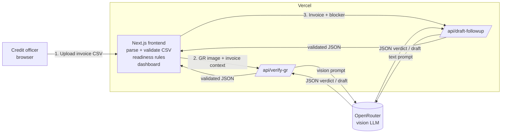

# Architecture Notes – GR Check

**Author:** Nicolo Ruiz · **Status:** v2.1 (aligned with spec v2.1) · Related: [PRD](PRD.md), [spec](../spec.md)

## 1. Overview

GR Check is a single web app with two halves:

- **Browser (frontend):** uploads the invoice CSV, calculates payment readiness, and shows the dashboard. All number-crunching happens here, in plain code (no AI).
- **Server (API routes):** the only place that talks to the AI. It receives a GR image plus invoice details, calls a vision model through OpenRouter, and returns a structured verdict or a draft follow-up message.



## 2. Components

| Component | Responsibility | Technology |
|---|---|---|
| Frontend UI | Upload page, dashboard, invoice detail and GR-check panel | Next.js (App Router), React, TypeScript, Tailwind CSS |
| CSV parser + validator | Read the CSV, check columns, types and dates; report row errors | PapaParse + Zod |
| QR decoder | Detect and decode a QR code in the uploaded GR image before the AI call (vision models can't reliably read QR codes) | `jsQR` in the browser |
| Readiness engine | Days overdue, aging buckets, 3-condition check, blockers, early-warning priority | Pure TypeScript functions in `lib/readiness.ts` (unit-tested) |
| `/api/verify-gr` | Validate the upload, send image + context to the vision model, return a structured verdict | Next.js route handler + Vercel AI SDK (`generateObject`) + OpenRouter provider |
| Verdict guards | After every AI answer: **received-date validation runs in code** (on or after delivery, not after today; the AI only reads the date), then the low-confidence, consistency and QR guards from spec section 6 | Pure TypeScript functions in `lib/grGuards.ts` (unit-tested) |
| `/api/draft-followup` | Generate a follow-up message for the right party | Next.js route handler + Vercel AI SDK |
| AI provider | Access to LLMs with one key | OpenRouter (school-provided key) |
| Monitoring | Page views and basic usage | Vercel Analytics; server logs for errors (no document content logged) |
| CI | Lint, type-check, test, build on every push | GitHub Actions |
| Hosting | Live URL, environment variables | Vercel |

## 3. Data flow

1. **Upload:** the user uploads `invoices.csv` (or clicks *Load sample data*). The browser parses and validates it. Invalid rows are listed with the reason.
2. **Calculate:** the readiness engine computes, for each invoice: days overdue, aging bucket, days since delivery, payment-ready status, blockers, and an early-warning flag with a priority score.
3. **Review:** the dashboard shows the KPIs, the **Early warning** list, the **Blocked 60+** list and all invoices.
4. **Verify GR:** the user opens an invoice and uploads a GR image. The browser first scans it for a QR code and decodes it if present. It then sends the image plus invoice context to `/api/verify-gr`. The server calls the vision model and returns a verdict (**VALID / INVALID / NEEDS_REVIEW**) with the extracted fields and reasons. The browser updates that invoice's GR status for the session.
5. **Act:** the user clicks *Draft follow-up*; `/api/draft-followup` returns a message addressed to the right party, and the user copies it.

## 4. Key design decisions

| Decision | Why | Trade-off |
|---|---|---|
| **No database in v1** | Simpler build; no customer data stored anywhere (privacy); fits the dummy-data scope | Results are lost on refresh. Users re-upload; persistence is a v2 item |
| **No login in v1** | Single-user demo; faster to build and test | The live URL is public, so cost guards are needed (below) |
| **Calculations in code, judgement in AI** | LLMs are unreliable at arithmetic and dates; code is testable | Two layers to maintain |
| **Structured AI output (JSON schema)** | Predictable UI, easy validation, safer than free text | Model must support structured output; fall back to NEEDS_REVIEW on failure |
| **Model set by environment variable** | The school key's allowed models are unconfirmed; switch without code changes | Must test each model's vision quality |
| **Images only for GR upload in v1** (JPG/PNG/WebP) | Covers phone photos, scans saved as images, and screenshots of e-acknowledgements | PDF upload is a v2 item |

## 5. Security and cost guards

- The `OPENROUTER_API_KEY` lives **only** in `.env.local` (local) and Vercel Environment Variables (live). It is never sent to the browser and never committed.
- All AI calls go through server routes; the browser never calls OpenRouter directly.
- **Input validation** (Zod) on every API request: file type (JPG/PNG/WebP), file size ≤ 4 MB, required invoice fields, text length limits.
- **Cost guards for a public URL:** request size limit, a simple per-IP rate limit on the AI routes (e.g. 20 requests per 10 minutes), and a credit limit on the OpenRouter key.
- **Prompt-injection guard:** text found inside an uploaded image is treated as data, never as instructions (stated in the system prompt); the output is schema-validated.
- **Privacy:** dummy data only; uploaded images are processed in memory and not stored; logs never include image content or names.

## 6. Environment variables

| Name | Example | Where |
|---|---|---|
| `OPENROUTER_API_KEY` | `sk-or-...` | `.env.local` + Vercel (secret) |
| `OPENROUTER_MODEL` | a vision-capable model ID; confirmed in Phase 3: `google/gemini-3.8-flash` | `.env.local` + Vercel |

A committed `.env.example` lists these names with **empty values**.

## 7. Deployment and CI/CD

- **GitHub Actions** (`.github/workflows/ci.yml`): on every push and pull request, run `npm ci` → lint → type-check → `npm test` → `npm run build`.
- **Vercel** is connected to the GitHub repo: every push to `main` deploys to the live URL; pull requests get preview URLs.
- **Monitoring:** Vercel Analytics enabled; the Vercel function logs are checked for API errors.

## 8. Folder structure (planned)

```
/app
  page.tsx                  # upload + dashboard (single page)
  api/verify-gr/route.ts    # AI: GR verification
  api/draft-followup/route.ts # AI: follow-up message
/components                 # UI pieces (KPI tiles, tables, GR panel)
/lib
  csv.ts                    # parse + validate CSV
  readiness.ts              # business rules (pure functions)
  schemas.ts                # Zod schemas (CSV row, API input, AI output)
  ai.ts                     # OpenRouter client + prompts
  rateLimit.ts              # simple per-IP limiter
/public/sample
  invoices.csv              # dummy invoice register
  gr/*.png                  # dummy GR images (signed with/without stamp, wrong signer, unsigned, e-ack, QR)
/tests                      # Vitest unit tests
/docs                       # validation, PRD, architecture
spec.md · CLAUDE.md · .cursorrules · .env.example · README.md
```
